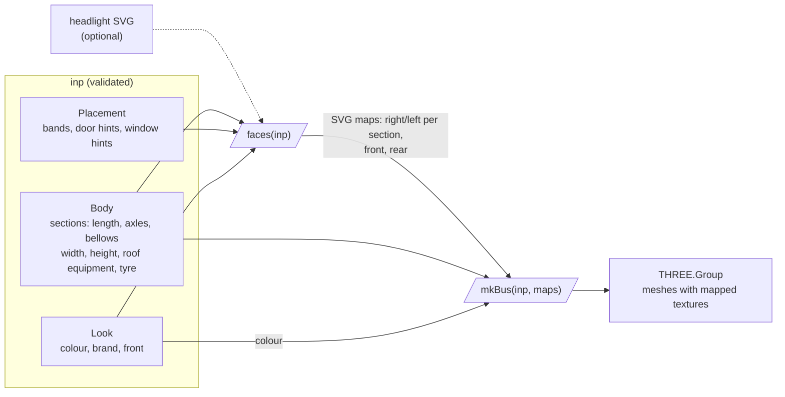

# iteru-3dbus

[](https://www.npmjs.com/package/@entur/iteru-3dbus)
[](https://github.com/entur/iteru-3dbus/blob/main/LICENSE.txt)

A boxy 3D bus in three.js, drawn from one JSON input: sections, axles, bellows, doors, windows, colour and front.

**Live:** <https://entur.github.io/iteru-3dbus/>, with two concrete buses
([`?bus=volvo-8900`](https://entur.github.io/iteru-3dbus/?bus=volvo-8900)) and the Bus Nordic 2.0 bus types as cards
([`#busnordic`](https://entur.github.io/iteru-3dbus/#busnordic)).

## Install

```sh
npm i @entur/iteru-3dbus three@^0.180.0
```

ES modules only. `three` is a peer: the host brings its own.

## Use

```js
import { validate, faces, mkBus } from "@entur/iteru-3dbus";

const errs = validate(inp); // string[], empty when valid; faces and mkBus take a valid inp
const maps = faces(inp); // SVG maps per box side, in mm; { headlight: svg } swaps the headlight drawing
scene.add(mkBus(inp, maps)); // a THREE.Group in metres: front end at x = 0, ground at y = 0
```

`inp` is one object against [`schema/bus-input.schema.json`](https://github.com/entur/iteru-3dbus/blob/main/schema/bus-input.schema.json)
(contract v2.0), lengths in mm. [`examples/`](https://github.com/entur/iteru-3dbus/tree/main/examples) has two
concrete buses and, in `busnordic/`, one bus per row of the Bus Nordic 2.0 "Examples of bus types" tables (17). The
standard gives those a class, a maximum length, a floor type and a door count; every other dimension is generic, not measured.

| Import | Gives | Needs |
| --- | --- | --- |
| `@entur/iteru-3dbus/core` | `validate`, `schema`, the derived numbers (`layout`, `doors`, `windows`, …), `MM` | nothing: runs in node |
| `@entur/iteru-3dbus/faces` | `faces`: the SVG maps alone | a DOM, no three |
| `@entur/iteru-3dbus` | all of the above, `mkBus`, `mapErrs`; an optional stage (`mkStage`, `mkStageShot`) and camera views (`mkViews`, `VIEWS`) | a DOM and three |

### As a custom element

[`guide/bus-3d.js`](https://github.com/entur/iteru-3dbus/blob/main/guide/bus-3d.js) wraps the library as `<bus-3d>`,
with the rebuild, camera, error events and disposal a host needs. It is the user guide's example, not part of the
package: copy it and point its one import at `@entur/iteru-3dbus`. The demo app is its host.

## How it works



`faces` is the single source of surface detail: the same maps are the model's textures and the demo app's map card.
`mkBus` extrudes each section, cuts the wheel arches, adds wheels, bellows and roof pod, and maps the textures on.

## Limits (v1)

- `photo` is accepted and ignored: no ML branch yet (full pipeline: [`docs/flowchart.html`](docs/flowchart.html)).
- One generic front; `front.template` and rear templates are not drawn.
- Doors on the right side only; `door_side` is not honoured, door overlap (rule 5) is not checked.
- One deck: `low_floor_lower_level` is not drawn as two.

Remaining work: [issues](https://github.com/entur/iteru-3dbus/issues).

## Develop

```sh
npm i
npm run dev                              # the demo app; ?bus=volvo-8900 picks an example
npm test
npm run validate -- examples/*.json examples/busnordic/*.json
npm run build:lib                        # the package, in dist-lib/
```

The demo app deploys from `main` by `.github/workflows/pages.yml`.

## Release

```sh
npm version minor --no-git-tag-version   # in a PR; merge it
git tag v$(node -p "require('./package.json').version") && git push origin --tags   # on main, after the merge
```

The tag runs `.github/workflows/release.yml`: tests, then `npm pack`, then a GitHub Release with the tarball
(`entur-iteru-3dbus-<version>.tgz`, and `entur-iteru-3dbus.tgz` for `releases/latest/download/`) and generated notes,
then `npm publish` of that same tarball. A tag with a `-` (`v0.2.0-rc.1`) makes a prerelease, published under `next`.

CI publishes through npm trusted publishing: the registry accepts `release.yml` of this repo by OIDC, no token.
That trust can only be set on a package that exists, so the first version went up by hand:
[`scripts/publish-by-hand.sh`](scripts/publish-by-hand.sh) publishes a tag from a worktree and sets the trust.

## License

[EUPL-1.2](LICENSE.txt)
