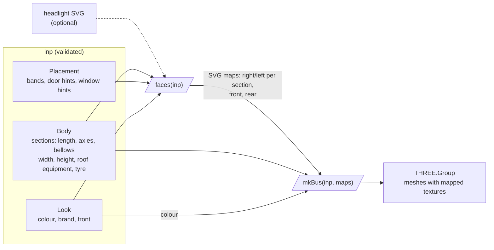

# 3dbus

Boxy 3D bus rendered in three.js from one input JSON (`schema/bus-input.schema.json`).
v1 has no ML branch: the schema's `photo` field is accepted and ignored.

Live: <https://entur.github.io/iteru-3dbus/> ([`?bus=citaro-g`](https://entur.github.io/iteru-3dbus/?bus=citaro-g)), deployed from `main` by `.github/workflows/pages.yml`.



```sh
npm i
npm run dev                              # ?bus=citaro-g picks the other example
npm test
npm run validate -- examples/*.json
```

As a library, in any host (`npm run build:lib` builds it to `dist-lib/`, three and ajv left to the host):

```js
import { validate, faces, mkBus } from "3dbus";

const errs = validate(inp); // string[], empty when valid; faces and mkBus take a valid inp
const maps = faces(inp); // SVG maps per box side, in mm; { headlight: svg } swaps the headlight drawing
scene.add(mkBus(inp, maps)); // a THREE.Group in metres: front end at x = 0, ground at y = 0
```

`3dbus/core` is the part without DOM or three (schema, `validate`, the derived numbers), `3dbus/faces`
the maps alone, without three. `mkStage` and `mkViews` are an optional stage and named camera views.

User guide example: [`guide/bus-3d.js`](guide/bus-3d.js) wraps the library as one custom element, `<bus-3d>`,
with the rebuild, camera and disposal handling a host needs. The app here is its host; it is not part of the package.

Remaining work: [issues](https://github.com/entur/iteru-3dbus/issues).
Full pipeline including the ML branch: `docs/flowchart.html`.
