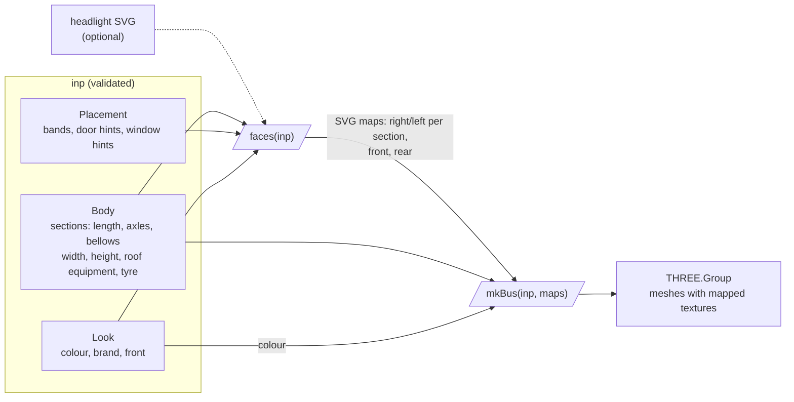

# 3dbus

Boxy 3D bus rendered in three.js from one input JSON (`schema/bus-input.schema.json`).
v1 has no ML branch: the schema's `photo` field is accepted and ignored.

Live: <https://entur.github.io/iteru-3dbus/> ([`?bus=citaro-g`](https://entur.github.io/iteru-3dbus/?bus=citaro-g)), deployed from `main` by `.github/workflows/pages.yml`.



```sh
npm i
npm run dev                              # ?bus=citaro-g picks the other example
npm test
npm run validate -- examples/*.json
```

As components, in any host (`npm run build:lib` builds them to `dist-lib/`):

```js
import "3dbus/bus-2d"; // <bus-2d>: the 2D face maps, no three.js
import "3dbus/bus-3d"; // <bus-3d>: the 3D model, takes the maps as input

map.headlight = svg; // optional, before inp: an <svg viewBox> of the left headlight, mirrored for the right one
map.inp = inp; // synchronous: map.faces is current on the next line
bus.faces = map.faces;
bus.inp = inp;
```

Remaining work: [issues](https://github.com/entur/iteru-3dbus/issues).
Full pipeline including the ML branch: `docs/flowchart.html`.
