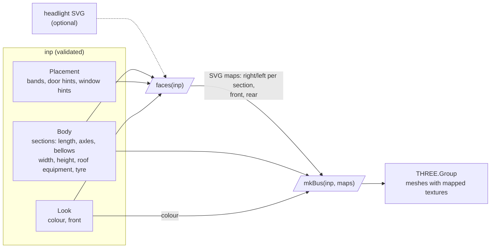

# iteru-3dbus

[](https://www.npmjs.com/package/@entur/iteru-3dbus)
[](https://github.com/entur/iteru-3dbus/blob/main/LICENSE.txt)

A boxy 3D bus in three.js, drawn from one JSON input (A), which can be read from a NeTEx `VehicleType` file (B): sections, axles, bellows, doors, windows, colour and front.

**Live:** <https://entur.github.io/iteru-3dbus/>: every example as a card
([`list`](https://entur.github.io/iteru-3dbus/list)), two concrete buses and the Bus Nordic 2.0 bus types, each one
in the viewer ([`bus?file=volvo-8900.xml`](https://entur.github.io/iteru-3dbus/bus?file=volvo-8900.xml)).

## Install

```sh
npm i @entur/iteru-3dbus three@^0.180.0
```

ES modules only. `three` is a peer: the host brings its own.

## Use

```js
import { validate, faces, mkBus } from "@entur/iteru-3dbus";

const errs = validate(inp); // string[], empty when valid; faces and mkBus take a valid inp
const maps = faces(inp); // SVG maps per box side, in mm; { headlight: svg } swaps the headlight drawing
scene.add(mkBus(inp, maps)); // a THREE.Group in metres: front end at x = 0, ground at y = 0
```

`inp` is one object against [`schema/bus-input.schema.json`](https://github.com/entur/iteru-3dbus/blob/main/schema/bus-input.schema.json)
(contract v3.0), lengths in mm. [`examples/`](https://github.com/entur/iteru-3dbus/tree/main/examples) has two
concrete buses as NeTEx XML and, in `busnordic/`, one bus per row of the Bus Nordic 2.0 "Examples of bus types" tables (17). The
standard gives those a class, a maximum length, a floor type and a door count; every other dimension is generic, not measured.

**Schema 3.0 is a breaking change** (package 0.2.0): the input holds only what is drawn. `brand`, `model`,
`bus_class`, `floor_type`, `body`, `door_side`, `front.template`, `photo`, `meta` and `base_color.name` are gone; the
badge is `front.badge_text` and the display `front_display`, nothing falls back to anything else. A section takes
absolute `doors` (`x_mm`, `width_mm`, `leaves`, `glazed`) or `doors_hint`, never both. Inputs of 2.0 need these
fields removed and `schema_version` set to `"3.0"`.

| Import | Gives | Needs |
| --- | --- | --- |
| `@entur/iteru-3dbus/core` | `validate`, `limits`, `schema`, the derived numbers (`layout`, `doors`, `windows`, …), `MM` | nothing: runs in node |
| `@entur/iteru-3dbus/limits` | `limits`: the Nordic limits as messages, on top of `validate` | nothing: runs in node |
| `@entur/iteru-3dbus/netex` | `fromNetex`, `KEYS`, `PREFIX`: a NeTEx `VehicleType` read into the input | nothing: runs in node; `fast-xml-parser` and `ajv` are dependencies |
| `@entur/iteru-3dbus/faces` | `faces`: the SVG maps alone | a DOM, no three |
| `@entur/iteru-3dbus` | all of the above (`./netex` too), `mkBus`, `mapErrs`; an optional stage (`mkStage`, `mkStageShot`) and camera views (`mkViews`, `VIEWS`) | a DOM and three |

### A and B

A is the input above. B is NeTEx: a `VehicleType`, with its `DeckPlan` (one `Deck` per section, `PassengerEntrance`
per door) and `VehicleModel` (the badge) when the file has them. What NeTEx has no element for goes in
`KeyValue`s under the prefix `3dbus:` (`KEYS` lists them per element). A `VehicleType` without a `DeckPlan` is one
section: `axles_mm`, `windows_count` and `doors_hint` (`zone:leaves[:bias][:axle_gap]`, comma-separated, e.g.
`front_overhang:2,between_axles:2:rear`) are its KeyValues, so its doors are hints.

```js
import { fromNetex, validate, limits } from "@entur/iteru-3dbus";

const r = fromNetex(xml); // { ok: true, inp, warns } or { ok: false, errs }; { prefix, id } as a second argument
const errs = r.ok ? [...validate(r.inp), ...limits(r.inp)] : r.errs; // limits are optional: a fantasy bus has none
```

`fromNetex` parses, picks, checks the NeTEx shape (a slice of the schema, made by
[`scripts/netex-slice.js`](scripts/netex-slice.js)), reads the KeyValues, builds the input and runs `validate`; every
error names its element or key. `limits` holds the Nordic length, width, height and door-count limits; **its Bus Nordic
2.0 numbers have not been checked against the document.** The demo app has a "Nordic-limited | Fantasy bus" switch
for them. A `Length` more than 10 mm off the sections' sum is a warning; a second deck level is not supported.

### As a custom element

[`guide/bus-3d.js`](https://github.com/entur/iteru-3dbus/blob/main/guide/bus-3d.js) wraps the library as `<bus-3d>`,
with the rebuild, camera, error events and disposal a host needs. It is the user guide's example, not part of the
package: copy it and point its one import at `@entur/iteru-3dbus`. The demo app is its host.

## How it works



`faces` is the single source of surface detail: the same maps are the model's textures and the demo app's map card.
`mkBus` extrudes each section, cuts the wheel arches, adds wheels, bellows and roof pod, and maps the textures on.

## Limits (v1)

- No ML branch yet (full pipeline: [`docs/flowchart.html`](docs/flowchart.html)).
- One generic front; rear templates are not drawn.
- Doors on the right side only.
- At most two decks: a third DeckLevel is rejected. The upper deck is a window band (`upper_win_band_height_mm`), drawn the same along the whole bus.

Remaining work: [issues](https://github.com/entur/iteru-3dbus/issues).

## Develop

```sh
npm i
npm run dev                              # the demo app: /list, /bus?file=volvo-8900.xml
npm test
npm run validate -- examples/*.xml examples/busnordic/*.xml   # .xml through fromNetex, else input JSON
npm run build:lib                        # the package, in dist-lib/
```

The demo app deploys from `main` by `.github/workflows/pages.yml`.

## Release

```sh
npm version minor --no-git-tag-version   # in a PR; merge it
git tag v$(node -p "require('./package.json').version") && git push origin --tags   # on main, after the merge
```

The tag runs `.github/workflows/release.yml`: tests, then `npm pack`, then a GitHub Release with the tarball
(`entur-iteru-3dbus-<version>.tgz`, and `entur-iteru-3dbus.tgz` for `releases/latest/download/`) and generated notes,
then `npm publish` of that same tarball. A tag with a `-` (`v0.2.0-rc.1`) makes a prerelease, published under `next`.

CI publishes through npm trusted publishing: the registry accepts `release.yml` of this repo by OIDC, no token.
That trust can only be set on a package that exists, so the first version went up by hand:
[`scripts/publish-by-hand.sh`](scripts/publish-by-hand.sh) publishes a tag from a worktree and sets the trust.

## License

[EUPL-1.2](LICENSE.txt)
